# Informe de Salud Digital: auditoría de seguridad personal

**Proyecto final, Curso de Ciberseguridad de Coderhouse**

| | |
|---|---|
| **Autora** | Hannah Abeledo |
| **Fecha de entrega** | Octubre de 2026 |
| **Fecha de las pruebas** | Del 27 de septiembre al 5 de octubre de 2026 |
| **Trabajos que integra** | Módulos 2, 3, 5 y 7, y partes de las prácticas de riesgos, phishing y Wi-Fi segura |

> **Sobre esta versión:** es el informe que entregué en el curso, adaptado para publicarlo. Saqué lo que identifica mi red, mis equipos y mis cuentas (el modelo del router, el proveedor de Internet, el nombre del Wi-Fi, las direcciones MAC y sus fabricantes, las IPv6 del proveedor y los nombres de los servicios que uso), y no incluí la foto de la etiqueta del router (Fig. B8). El análisis y los resultados son los mismos.

> **Actualización de noviembre de 2026:** después de entregar el trabajo apliqué el plan y repetí los escaneos. Eso está en la [sección 7](#7-remediación-y-verificación-noviembre-de-2026). Las secciones 1 a 6 cuentan cómo estaba todo en octubre.

## Declaración ética

**Autorización:** todas las pruebas las hice sobre cosas mías: mi computadora, la máquina virtual del laboratorio, mis cuentas y la red Wi-Fi de mi casa, de la que soy titular. No escaneé ni capturé tráfico de equipos o redes de otras personas.

**Alcance:** analicé a fondo solo dos equipos, mi computadora y el router. Del resto de los dispositivos de la casa solo registré que estaban conectados (con `nmap -sn`), sin escanear sus puertos. La captura de Wireshark la hice sobre mi propia conexión mientras entraba a dos sitios de prueba (neverssl.com y wikipedia.org). Las cuentas que cargué en la bóveda de contraseñas son inventadas.

**Datos ocultos:** en las capturas los rectángulos negros tapan datos que identifican mi red o mis equipos. Las IP que se ven (192.168.0.x) son privadas: solo existen dentro de mi red y no sirven para ubicarme desde Internet.

## Índice

1. [Resumen ejecutivo](#1-resumen-ejecutivo)
2. [Alcance y metodología](#2-alcance-y-metodología)
3. [Inventario de activos](#3-inventario-de-activos)
4. [Análisis de vulnerabilidades detectadas](#4-análisis-de-vulnerabilidades-detectadas)
5. [Acciones de mitigación (hardening)](#5-acciones-de-mitigación-hardening)
6. [Conclusión](#6-conclusión)
7. [Remediación y verificación (noviembre de 2026)](#7-remediación-y-verificación-noviembre-de-2026)
8. [Anexo de evidencias](#anexo-de-evidencias)

A lo largo del informe hago referencia a las capturas del anexo con su número (por ejemplo, Fig. B5). La letra indica la herramienta y el número, el orden.

---

## 1. Resumen ejecutivo

En este trabajo junté lo que hice en los laboratorios del curso: escaneé mi red de casa con Nmap, capturé mi propio tráfico con Wireshark, armé una máquina virtual con un hardening básico y creé una bóveda de contraseñas y un contenedor cifrado. La idea es responder qué tan segura es mi "postura digital".

> **Conclusión general:** mi postura digital es intermedia. Mi computadora está bastante bien protegida, pero encontré problemas importantes en el router de casa y en cómo manejo las contraseñas de mis cuentas.

| Área | Estado | Motivo |
|---|---|---|
| Red de casa (router) | Riesgo alto | Conserva las contraseñas de fábrica (Wi-Fi y administrador), impresas en la etiqueta. El panel también se puede abrir por HTTP sin cifrar y tiene dos servicios que no pude identificar. |
| Cuentas y contraseñas | Riesgo medio | La bóveda ya funciona, pero en las cuentas reales había contraseñas repetidas y una cuenta financiera sin doble factor de autenticación. |
| Navegación | Riesgo medio | Comprobé que en HTTP se puede leer todo. Con HTTPS el contenido está cifrado, pero igual se ve a qué sitio me conecto (DNS y SNI). |
| Mi computadora | Riesgo bajo | Solo tiene 2 puertos abiertos de 1000 (AirPlay) y el sistema está actualizado. Hay algunas mejoras chicas para hacer. |
| Archivos sensibles | Protegido | Contenedor de VeraCrypt cifrado con AES y copia de la cabecera. Sin la contraseña no se puede leer. |
| Máquina virtual | Protegido | Red NAT, usuario estándar para el día a día, sistema actualizado, escritorio remoto apagado y snapshot "Hardening Inicial". |

**Riesgos más importantes**

1. **Router con las contraseñas de fábrica (R1):** cualquiera que vea la etiqueta puede entrar al Wi-Fi y al panel de administración, y desde ahí podría mandar a todos los equipos de la casa a páginas falsas.
2. **Cuenta financiera sin doble factor (I2):** si una contraseña repetida se filtra en otro sitio, alcanzaría para entrar a la cuenta y operar.
3. **Tráfico sin cifrar (W1):** lo que viaja por HTTP, incluido el panel del router por el puerto 80, lo puede leer cualquiera conectado a la misma red.

**Lo que ya tengo resuelto**

- Una máquina virtual aislada para hacer pruebas, con punto de restauración.
- Una bóveda de contraseñas con claves únicas de 24 caracteres.
- Un contenedor cifrado y la prueba de que sin la contraseña no se puede leer.

Lo primero es cambiar las contraseñas del router y activar el doble factor en las cuentas más importantes. Son cosas rápidas y resuelven los dos riesgos más altos. El plan completo está en la sección 5.2.

---

## 2. Alcance y metodología

### Trabajos que integra este informe

| Módulo | Práctica | Herramientas | Qué aporta |
|---|---|---|---|
| 2 | Laboratorio virtual con hardening | VirtualBox 7.2, Ubuntu 26.04.1 LTS | Medidas aplicadas en la VM (Anexo A) |
| 3 | Análisis de tráfico HTTP y HTTPS | Wireshark 4.6.9 | Hallazgos sobre protocolos (Anexo C) |
| 5 | Bóveda de contraseñas y contenedor cifrado | KeePassXC 2.7.6, VeraCrypt 1.26.29 | Gestión de identidad y cifrado (Anexos D y E) |
| 7 | Auditoría de la red de casa | Nmap 7.98 | Inventario de dispositivos y puertos (Anexo B) |
| 1, 4 y 6 | Activos y riesgos, phishing, Wi-Fi pública | Análisis teórico y herramientas del navegador | Activos de información y riesgos de identidad |

### Diferencia entre puerto y protocolo

Como uso dos herramientas que muestran cosas distintas, aclaro cómo uso cada término:

- **Puerto (Nmap):** es un número (de 0 a 65535) que funciona como una "puerta" de un equipo, donde puede haber un programa escuchando. Nmap me dice el estado de cada puerto (abierto, cerrado o filtrado) e intenta adivinar qué servicio hay. Por ejemplo: "el router tiene abierto el puerto 80".
- **Protocolo (Wireshark):** es el "idioma" que usan dos equipos para comunicarse. Wireshark lo reconoce leyendo el contenido de los paquetes. Por ejemplo: "ese paquete es HTTP".
- Normalmente HTTP usa el puerto 80 y HTTPS el 443, pero es una costumbre, no una regla. Por eso Nmap a veces pone un "?" cuando no está seguro de qué servicio hay en un puerto (como en el 9090 del router).

### Cómo clasifiqué la gravedad

Para cada hallazgo me hice dos preguntas: ¿qué tan fácil es aprovecharlo? y ¿cuánto daño podría causar?

| Gravedad | Criterio |
|---|---|
| Alta | Es fácil de aprovechar (no hace falta saber de informática) y afecta a toda la red, a mi dinero o a mis cuentas. |
| Media | Hace falta estar conectado a la red o alguna otra condición, pero el daño sería importante. |
| Baja | Afecta a un solo equipo o a la privacidad, o ya hay algo que lo protege. |
| Informativa | No es un riesgo en sí, pero conviene anotarlo o verificarlo. |

También tomé como referencia dos principios que vimos en el curso: **mínimo servicio necesario** (un equipo solo debería tener abiertos los servicios que se usan) y **mínimo privilegio** (cada usuario o programa solo debería tener los permisos que necesita).

### Limitaciones

- Con Nmap analicé los 1000 puertos TCP más comunes. No revisé puertos UDP ni si mis direcciones IPv6 públicas se pueden ver desde Internet.
- La detección de sistema operativo de Nmap es una estimación. En la Mac se equivocó de versión (hallazgo M4), así que siempre la comparé con el dato real.
- La IP de mi Mac cambió entre un trabajo y otro (192.168.0.67 en Wireshark y 192.168.0.24 en Nmap) porque el router la asigna automáticamente (DHCP).

---

## 3. Inventario de activos

Dividí el inventario en tres partes: los dispositivos que encontré en la red con Nmap, el software que analicé o usé, y mis activos de información (cuentas y datos), que al final es lo que quiero proteger.

### 3.1 Dispositivos de la red de casa (Nmap)

Con el comando `sudo nmap -sn 192.168.0.0/24` encontré **17 equipos activos** de 256 direcciones posibles, en 12,39 segundos (Fig. B2 y B3). Nmap muestra el fabricante a partir de la primera mitad de la dirección MAC. En esta versión pública agrupé los equipos por tipo en lugar de mostrar fabricantes y MAC.

| Tipo de equipo | Cantidad | Análisis |
|---|---|---|
| Router del proveedor de Internet (192.168.0.1) | 1 | Completo |
| Otro equipo del proveedor | 1 | Solo presencia |
| Mi computadora (192.168.0.24) | 1 | Completo |
| Electrodomésticos y dispositivos inteligentes (IoT) | 4 | Solo presencia |
| Consola, equipo de red y otros dispositivos de marca identificable | 4 | Solo presencia |
| "Unknown" (probablemente celulares con MAC aleatoria) | 5 | Solo presencia |
| Máquina virtual desde la que escaneé (192.168.0.66) | 1 | Equipo auditor |

Los "Unknown" seguramente son celulares que usan una MAC aleatoria, y por eso Nmap no puede saber la marca.

### 3.2 Los dos equipos que analicé a fondo

| Dato | Mi computadora | Router |
|---|---|---|
| Equipo | MacBook Air (Apple M4) | Router entregado por el proveedor de Internet |
| IP | 192.168.0.24 | 192.168.0.1 |
| Sistema real | macOS Tahoe 26 (Fig. B4) | Firmware del proveedor basado en Linux (no se puede ver desde afuera) |
| Sistema según Nmap | macOS 11 a 13 (incorrecto) | OpenWrt / Linux 3.18 (92 %, sin coincidencia exacta) |
| Puertos abiertos | 5000 y 7000 (AirPlay) | 53, 80, 443, 9090 y 49152 |
| Por qué lo elegí | Es donde tengo mis cuentas, archivos y la bóveda | Todos los demás equipos se conectan a través de él |

### 3.3 Software analizado y utilizado

| Software | Versión | Para qué |
|---|---|---|
| macOS | Tahoe 26 | Sistema de mi computadora (equipo analizado) |
| VirtualBox | 7.2 | Para correr la máquina virtual del laboratorio |
| Ubuntu Desktop | 26.04.1 LTS (Fig. A9) | Sistema de la máquina virtual |
| Nmap | 7.98 (Fig. B1) | Encontrar equipos y escanear puertos |
| Wireshark | 4.6.9 | Capturar y analizar el tráfico |
| KeePassXC | 2.7.6 | Bóveda de contraseñas (la usé en lugar de Bitwarden) |
| VeraCrypt | 1.26.29 | Contenedor cifrado |
| Servicios del router | DNS, panel web ("HTTP Server"), puertos 9090 y 49152 sin identificar | Software expuesto en la red de casa |
| AirPlay de la Mac | AirTunes (Fig. B7) | Software expuesto en la red de casa |

### 3.4 Activos de información

Para cada activo analicé la tríada CID (Confidencialidad, Integridad y Disponibilidad), su principal vulnerabilidad, la amenaza y qué podría pasar en concreto si alguien la aprovecha.

**Activo 1: Correo electrónico principal**

| | |
|---|---|
| Confidencialidad | Tiene información personal y del trabajo, y además ahí llegan los mails para recuperar o cambiar las contraseñas de casi todas las otras cuentas. |
| Integridad | Los mails y la configuración no deberían poder cambiarse sin mi permiso. Por ejemplo, si alguien agrega un filtro o un reenvío, podría esconderme avisos de seguridad o recibir copia de todo lo que me llega. |
| Disponibilidad | Lo uso todos los días. Si pierdo el acceso, tampoco puedo recuperar mis otras cuentas. |
| Vulnerabilidad | Contraseñas repetidas entre cuentas. |
| Amenaza | Phishing: un mail falso que lleva a una página parecida a la del proveedor de correo para que ponga mi contraseña. |
| Escenario de riesgo | Con la contraseña, el atacante entra al correo, crea un filtro para que no vea los avisos y usa "olvidé mi contraseña" en otros servicios para quedarse con esas cuentas. **Impacto:** pierdo el control de varias cuentas a la vez y podrían mandar estafas en mi nombre a mis contactos. |

**Activo 2: Fotos personales en la nube**

| | |
|---|---|
| Confidencialidad | Hay fotos privadas y capturas con datos personales que no quiero que vea nadie más. |
| Integridad | Nadie debería poder borrarlas, editarlas o reemplazarlas sin mi permiso. Como el servicio sincroniza, un cambio hecho desde un celular robado se copia en todos los dispositivos. |
| Disponibilidad | Tengo que poder verlas o descargarlas cuando las necesite. |
| Vulnerabilidad | No había una copia de seguridad fuera de la nube. |
| Amenaza | Robo o pérdida del celular, que tiene la sesión abierta. |
| Escenario de riesgo | Si alguien tiene el celular desbloqueado, puede ver, descargar o borrar las fotos, y como se sincroniza, desaparecen de todos los dispositivos. **Impacto:** se expone mi privacidad y puedo perder las fotos para siempre. |

**Activo 3: Home banking**

| | |
|---|---|
| Confidencialidad | Muestra saldos, movimientos y datos de las cuentas. |
| Integridad | Las transferencias, los destinatarios y los datos de contacto no deberían poder modificarse sin mi permiso. |
| Disponibilidad | Si no puedo entrar, no puedo pagar ni mover mi plata. |
| Vulnerabilidad | Sin doble factor de autenticación. |
| Amenaza | Que alguien pruebe usuarios y contraseñas filtrados de otros sitios (*credential stuffing*). |
| Escenario de riesgo | Si una contraseña usada en otro sitio aparece en una filtración, el atacante la prueba en el banco y, sin segundo factor, entra y opera: agrega una cuenta suya como destinatario, cambia el mail o teléfono de contacto para que no lleguen los avisos y transfiere la plata. Incluso podría pedir un préstamo preaprobado. **Impacto:** pérdida de dinero, posibles deudas y reclamos al banco. |

---

## 4. Análisis de vulnerabilidades detectadas

Agrupé los hallazgos según la herramienta con la que los encontré. Los de Nmap tienen que ver con puertos y servicios abiertos; los de Wireshark, con cómo viajan los datos según el protocolo; y los de identidad, con cómo manejo mis cuentas.

| ID | Hallazgo | Dónde | Gravedad | Evidencia |
|---|---|---|---|---|
| R1 | Contraseñas de fábrica (Wi-Fi y administrador) sin cambiar e impresas en la etiqueta | Router | **Alta** | B10 |
| I2 | Cuenta financiera sin doble factor de autenticación | Cuentas | **Alta** | Sección 3.4 |
| I1 | Contraseñas repetidas en cuentas reales | Cuentas | Media | Sección 3.4 |
| R2 | Panel de administración accesible por HTTP sin cifrar (puerto 80) | Router | Media | B10, B11 |
| W1 | Tráfico HTTP legible en texto plano | Navegación | Media | C4, C5 |
| R3 | Servicios sin identificar en los puertos 9090 y 49152 | Router | Media | B9, B10 |
| R4 | Dispositivos inteligentes en la misma red que la computadora | Red | Media | B2, B3 |
| W2 | DNS y nombre del sitio (SNI) visibles aunque se use HTTPS | Navegación | Baja | C3, C6 |
| M1 | Receptor AirPlay activo y visible en la red (puertos 5000 y 7000) | Mac | Baja | B5, B6, B7 |
| M2 | La Mac responde en los puertos cerrados (modo sigiloso apagado) | Mac | Baja | B5, B6 |
| M3 | "Dirección Wi-Fi privada" desactivada | Mac | Baja | B4 |
| R5 | Nmap estima un sistema viejo en el router (Linux 3.18), sin confirmar | Router | Informativa | B10 |
| M4 | Nmap se equivocó con la versión de macOS | Mac | Informativa | B4, B6 |

### 4.1 Hallazgos con Nmap (puertos y servicios)

A cada equipo le hice dos escaneos: `sudo nmap -sX -sV -O` (Xmas, el que pedía la consigna) y `sudo nmap -sS -sV -O` (SYN, el más común) para comparar. El Xmas manda paquetes con las banderas FIN, PSH y URG prendidas a la vez. Si el equipo no contesta, Nmap no sabe si el puerto está abierto o si lo bloqueó un firewall, y lo marca como `open|filtered`. El SYN, en cambio, imita el primer paso de una conexión normal y sí puede distinguir entre abierto, cerrado y filtrado.

**R1: Contraseñas de fábrica del router (gravedad alta)**

*¿Qué encontré?* La etiqueta del router tiene impresas la contraseña del Wi-Fi y el usuario y la contraseña del panel de administración, y nunca se habían cambiado. El escaneo confirma que el panel está activo en los puertos 80 y 443 (Fig. B10).

*¿Por qué importa?* Esas contraseñas no son secretas: las puede ver cualquiera que mire la etiqueta (una visita, un técnico, alguien que le saque una foto). Un ataque posible sería: (1) la persona se conecta al Wi-Fi con la clave de la etiqueta; (2) entra al panel con el usuario y la contraseña de administrador; (3) desde el panel cambia los servidores DNS para que, cuando alguien de la casa escriba la dirección del banco, termine en una página falsa. También podría abrir puertos hacia Internet o cambiar la clave del Wi-Fi y dejarnos sin conexión. Como todos los equipos de la casa pasan por el router, el impacto es sobre toda la red.

**R2: Panel del router por HTTP sin cifrar (gravedad media)**

*¿Qué encontré?* El panel responde por el puerto 443 (HTTPS) pero también por el 80 (HTTP). La respuesta del puerto 80 es `HTTP/1.0 301 Moved Permanently` con `Location: /2.0/gui/` (Fig. B11). Como la dirección a la que redirige es relativa, el navegador sigue en HTTP y nunca pasa a HTTPS.

*¿Por qué importa?* Por HTTP, el usuario, la contraseña y la cookie de sesión viajan en texto plano, igual que el tráfico que pude leer con Wireshark (W1). Si además se suma R1, a un atacante le alcanzaría con capturar mi inicio de sesión.

**R3: Servicios sin identificar en 9090 y 49152 (gravedad media)**

En el 9090 Nmap duda y pone `ssl/zeus-admin?`, y el 49152 aparece como `unknown` (Fig. B9 y B10). No puedo evaluar el riesgo de algo que no sé qué es. Investigando, vi que el 49152 suele usarse en routers para UPnP, que deja que cualquier dispositivo de la casa abra puertos hacia Internet sin pedir permiso. Es una hipótesis que tengo que confirmar en el panel.

**R4: Dispositivos inteligentes en la misma red (gravedad media)**

En la misma red que mi computadora hay aires acondicionados inteligentes, otros dispositivos IoT, equipos de red y una consola (sección 3.1). Este tipo de dispositivos suele recibir menos actualizaciones. Si alguno fuera hackeado, quedaría en la misma red que mi computadora y se podría usar para atacarla.

**R5: Sistema del router posiblemente viejo (informativa)**

Nmap estimó Linux 3.18 (de 2014) con un 92 % de coincidencia, pero no exacta. Como en la Mac Nmap se equivocó (M4), no puedo afirmar que sea un riesgo. Tengo que revisar la versión del firmware en el panel.

**M1 a M4: Mi computadora (exposición baja)**

Los dos escaneos dieron lo mismo: 998 puertos cerrados y solo 2 abiertos, el 5000 y el 7000 (Fig. B5 y B6). En la respuesta capturada aparece `Server: AirTunes` y `403 Forbidden` (Fig. B7), o sea que es el receptor de AirPlay de Apple y rechaza a quien no está autorizado.

- **M1, AirPlay visible (baja):** si no uso la Mac para recibir AirPlay, son dos puertos abiertos sin necesidad.
- **M2, modo sigiloso apagado (baja):** el mensaje `998 closed tcp ports (reset)` significa que la Mac contesta cada intento con un rechazo. Eso confirma que el equipo existe y le ayudó a Nmap a darse cuenta de que es una Mac.
- **M3, MAC real visible (baja):** tengo desactivada la "Dirección Wi-Fi privada" (Fig. B4), por eso Nmap reconoció que es Apple. En redes públicas, eso permite reconocer mi computadora en distintos lugares.
- **M4, versión equivocada (informativa):** Nmap dijo macOS 11 a 13 y en realidad tengo macOS 26. Aprendí que no hay que confiar en el resultado de `-O` sin verificarlo en el equipo.

### 4.2 Hallazgos con Wireshark (protocolos)

Capturé el tráfico de mi Wi-Fi (interfaz `en0`) mientras entraba a http://neverssl.com (sin cifrar) y a https://www.wikipedia.org (cifrado). Quedaron 6.270 paquetes. En la jerarquía de protocolos (Fig. C1 y C2) se ve que los que viajan sin cifrar son HTTP, DNS, ARP, MDNS y SSDP, y los cifrados son TLS (HTTPS) y QUIC.

**W1: HTTP viaja en texto plano (gravedad media)**

Con el filtro `http.request` se ven solo los pedidos que hace mi navegador. El pedido a neverssl.com es el paquete 2342 (Fig. C4). Después, con clic derecho → Follow → HTTP Stream, pude leer toda la conversación (Fig. C5). Este es un fragmento de lo que se veía:

```http
GET / HTTP/1.1
Host: neverssl.com
Connection: keep-alive
Upgrade-Insecure-Requests: 1
User-Agent: Mozilla/5.0 (Macintosh; Intel Mac OS X 10_15_7) AppleWebKit/537.36 (KHTML, like Gecko) Chrome/...
Accept: text/html,application/xhtml+xml,application/xml;q=0.9,image/avif,image/webp,...
Accept-Encoding: gzip, deflate
Accept-Language: es-ES,es;q=0.9

HTTP/1.1 200 OK
Date: Mon, 28 Sep 2026 03:18:24 GMT
Server: Apache/2.4.68 ()
Last-Modified: Wed, 29 Jun 2022 00:23:33 GMT
Content-Type: text/html; charset=UTF-8
...
<title>NeverSSL - Connecting ...</title>
```

Con esto, cualquiera en la misma red puede saber qué página pedí (Host y URI), qué navegador y sistema uso (User-Agent), mi idioma (Accept-Language), qué servidor respondió y todo el HTML de la página. Si la página hubiera tenido un formulario de login, el usuario y la contraseña se verían igual. Además, como HTTP no verifica nada, alguien en el medio podría modificar la página sin que yo me dé cuenta.

**W2: Lo que se sigue viendo con HTTPS (gravedad baja)**

En la conexión con Wikipedia, después del Client Hello y del Server Hello (TLS 1.3), todos los paquetes dicen solo *Application Data*, y en el Follow TCP Stream aparecen caracteres sin sentido (Fig. C6 y C7). Pero hay cosas que se siguen viendo: la consulta DNS, que viaja sin cifrar y muestra el dominio y la IP (por ejemplo, neverssl.com → 34.223.124.45 en la Fig. C3), y el nombre del sitio en el campo SNI del Client Hello. O sea, con HTTPS se puede saber a qué sitio me conecto, pero no qué hago ahí.

**Diferencia entre HTTP y HTTPS**

| ¿Qué se ve? | HTTP (puerto 80) | HTTPS = HTTP + TLS (puerto 443) |
|---|---|---|
| URL completa, método y encabezados | Se leen | Cifrados |
| Cookies de sesión | Se leen (se puede robar la sesión) | Cifradas |
| Contenido (formularios, contraseñas, HTML) | Se lee | Cifrado |
| ¿Se detecta si alguien modificó los datos? | No | Sí |
| ¿Se verifica que el sitio sea el real? (certificado) | No | Sí |
| Dominio (DNS y SNI) e IP de destino | Se ven | Se siguen viendo |

TLS da **confidencialidad** (solo mi navegador y el servidor pueden leer la información) e **integridad** (cada mensaje tiene un código de control, y si alguien cambia algo en el camino, la conexión lo detecta).

**Three-way handshake de TCP**

Con el filtro `tcp.flags.syn == 1` se ven los dos primeros pasos de cada conexión (Fig. C8). Para ver los tres pasos de la conexión con Wikipedia usé `tcp.stream eq 53` (Fig. C9).

En la tabla uso los números de secuencia relativos, que son los que muestra Wireshark en la lista de paquetes (la conexión arranca en 0). Entre paréntesis puse los absolutos (*raw*). Los del paquete 4138 los saqué directamente del panel de detalle (Fig. C9), y los de 4134 y 4139 los calculé a partir de esos, porque cada SYN suma uno.

| Nº | Origen → Destino | Flags | Seq relativo (absoluto) | Ack relativo (absoluto) | Para qué sirve |
|---|---|---|---|---|---|
| 4134 | Mi compu :63431 → Wikipedia :443 | SYN | 0 (838361992) | — | Pido abrir la conexión y mando mi número inicial |
| 4138 | Wikipedia :443 → Mi compu :63431 | SYN, ACK | 0 (2844174182) | 1 (838361993) | El servidor confirma y manda su número inicial |
| 4139 | Mi compu :63431 → Wikipedia :443 | ACK | 1 (838361993) | 1 (2844174183) | Confirmo y ya se pueden mandar datos |

### 4.3 Escenario de Wi-Fi pública

En la práctica de Wi-Fi segura vi qué puede ver alguien que está conectado a la misma red que yo. Las capturas de Wireshark de este informe muestran justamente eso: con el filtro `http.request`, un atacante vería en texto plano el método GET, la URL, el Host, el User-Agent y los encabezados (Fig. C4 y C5). Los riesgos son que me "escuchen" (*sniffing*), que me roben la sesión con las cookies, el ataque de intermediario (*Man-in-the-Middle*) y las redes falsas con nombres parecidos (*Evil Twin*).

**Qué cambiaría con una VPN (antes y después)**

| Lo que vería alguien en la misma Wi-Fi | Sin VPN | Con VPN |
|---|---|---|
| Paquetes | DNS, HTTP, TLS y QUIC hacia muchos destinos | Solo tráfico cifrado (UDP o TCP, según la VPN) hacia una sola IP: el servidor de la VPN |
| Consultas DNS | Se leen | Van dentro del túnel, no se ven |
| GET, URL, Host y encabezados de sitios HTTP | Se leen | No se ven |
| SNI de sitios HTTPS | Se lee | No se ve |
| Qué puede saber | Qué sitios visito y, en HTTP, qué hago | Solo que estoy usando una VPN y cuánto tráfico mando |

Igual la VPN tiene un límite: protege el camino entre mi compu y el servidor de la VPN. De ahí hasta el sitio, si el sitio es HTTP, los datos vuelven a viajar sin cifrar. Por eso la VPN no reemplaza a HTTPS, lo complementa. (Esta comparación es teórica: no hice una captura con la VPN prendida).

### 4.4 Hallazgos de identidad

**I1: Contraseñas repetidas (gravedad media)**

Había contraseñas repetidas entre cuentas personales. Si se filtra en un solo sitio, quedan expuestas todas las cuentas que la usan (ver activos 1 y 3 en la sección 3.4).

**I2: Cuenta financiera sin doble factor (gravedad alta)**

Es la cuenta donde está mi plata y dependía solo de la contraseña. Si además esa contraseña se repite en otros sitios (I1), un ataque de *credential stuffing* no necesita ningún conocimiento técnico.

**I3: Phishing**

En la práctica de phishing analicé un mail que pedía "confirmar datos bancarios" en `portal-universitario-pagos.net`. Corrijo algo que había puesto en ese trabajo: lo que había era un **dominio falso parecido al real** (registrado por el atacante para que suene oficial), no *spoofing* del remitente. Para hablar de spoofing tendría que comprobar en los encabezados del mail que el remitente se hace pasar por una dirección real de la universidad. Por eso, además de pasar el mouse por encima del link, conviene revisar la URL completa y los encabezados del mail (por ejemplo `Return-Path`, `Received` y los resultados de SPF, DKIM y DMARC).

---

## 5. Acciones de mitigación (hardening)

En esta sección separo lo que ya hice (con capturas en el anexo) de lo que quedó pendiente al momento de la entrega.

### 5.1 Medidas que ya apliqué

**A. Máquina virtual de pruebas (VirtualBox y Ubuntu)**

| Medida | Qué hice | Para qué sirve | Evidencia |
|---|---|---|---|
| Red aislada (NAT) | Configuré el adaptador en modo NAT antes de prender la VM. Para el escaneo con Nmap lo pasé a "Adaptador puente" y después lo volví a NAT. | La VM no se ve desde el resto de la red. Si algo adentro sale mal, no llega a mis otros equipos. | A1 |
| Mínimo privilegio | El usuario `hannah` es administrador y lo uso solo cuando hace falta (por ejemplo, para Nmap). Para el día a día uso `Practica-coder`, que es estándar. | Si hay un error o un malware en la cuenta estándar, el daño queda limitado a sus archivos. | A2 a A4 |
| Permisos de archivos | Usé `chmod 640` en un archivo de prueba: queda `-rw-r-----`. | Que otros usuarios no puedan leer lo que no les corresponde. | A5 |
| Sistema actualizado | `sudo apt update` y `sudo apt upgrade -y`. | Cerrar vulnerabilidades que ya se conocen. | A6 |
| Servicios apagados | Desactivé la compartición de escritorio y el control remoto. | Un acceso remoto que no uso es una puerta abierta de más. | A7 |
| Punto de restauración | Saqué un snapshot del estado limpio, al que le cambié el nombre a "Hardening Inicial", y otro llamado "Pre-auditoría de red" antes de pasar la red a modo puente. | Ver explicación abajo. | A8 |

*¿Para qué sirve un punto de restauración en un entorno de pruebas?* En un laboratorio de ciberseguridad se instalan programas, se cambia la configuración de red y más adelante se pueden analizar archivos sospechosos. Cualquiera de esas cosas puede dejar la máquina rota, mal configurada o infectada. El snapshot guarda cómo estaba la VM en un momento en que estaba limpia y funcionando. Así puedo volver a ese estado en segundos sin reinstalar nada, repetir una práctica desde las mismas condiciones para comparar resultados, animarme a probar cosas sabiendo que si sale mal no pierdo nada y, si la VM se infecta, descartar ese estado y volver al limpio. Por eso conviene sacar un snapshot antes de cada cambio riesgoso, como hice con "Pre-auditoría de red".

En la portada del TP 2 había puesto mal la versión del sistema. La verifiqué con `lsb_release -a` y es Ubuntu 26.04.1 LTS (Fig. A9). VirtualBox decía "Ubuntu 25.04" porque ese es solo el perfil que se elige al crear la VM, no lo que está instalado.

**B. Bóveda de contraseñas (KeePassXC)**

La consigna nombra Bitwarden, pero yo usé KeePassXC, que cumple la misma función. La diferencia es que guarda todo en un archivo cifrado en mi computadora y no depende de un servidor externo. La contra es que tengo que encargarme yo de las copias de seguridad.

- **Contraseña maestra:** una frase de paso larga (Fig. D1).
- **Tres cuentas de prueba** (correo, banco y red social inventados), cada una con una contraseña generada de 24 caracteres con los cuatro tipos de caracteres. El generador marca una entropía de 143 bits (Fig. D2 y D3).
- **Verificación:** el informe de KeePassXC muestra 3 contraseñas únicas, ninguna repetida, ninguna corta ni débil y un largo promedio de 24 caracteres (Fig. D4). Esto ataca el problema de las contraseñas repetidas (I1).

**C. Cifrado de archivos (VeraCrypt)**

- **Contenedor:** creé `Contenedor_Seguro.hc` con algoritmo AES (clave de 256 bits), hash HMAC-SHA-512 y formato exFAT, que se puede abrir en Windows, macOS y Linux (Fig. E1 a E4 y E6).
- **Uso:** lo monté en `/media/veracrypt1`, copié `evidencia.txt`, `secreto.txt` y una imagen, y borré los originales con `shred` para que no quedaran copias sin cifrar (Fig. E5, E7 y E8).
- **Copia de la cabecera:** desde Herramientas de volumen → Copia de Seguridad de Cabecera de Volumen generé el archivo `Contenedor_Seguro_cabecera_backup` (128 KiB), y VeraCrypt confirmó que se creó con éxito (Fig. E9 y E10). La cabecera guarda las claves: si se daña, se pierden los datos aunque sepa la contraseña.
- **Prueba:** con el volumen desmontado, si abro el archivo directamente solo se ven símbolos, y si busco las frases que guardé adentro, el resultado es 0 (Fig. E11).

*¿Por qué pedí 100 MB y VeraCrypt muestra 99 MB?* VeraCrypt cuenta los MB en base 2 (1 MB = 1.048.576 bytes, que en realidad se llama MiB). El archivo pesa 104.857.600 bytes, que son exactamente 100 MiB, o unos 104,9 MB "comunes" (Fig. E11). Cuando lo monto aparecen 99 MB porque VeraCrypt reserva 256 KiB para la cabecera y su copia interna (100 − 0,25 ≈ 99,8 MiB, que es el total que muestra el explorador en la Fig. E8), y el formato exFAT ocupa otro poco.

*Dónde guardar la copia de la cabecera:* tiene que estar separada del contenedor (por ejemplo, en un pendrive), junto con una copia del archivo cifrado, y conviene revisar cada tanto que las dos se puedan encontrar. Si estuvieran en el mismo disco y ese disco falla, la copia no serviría.

### 5.2 Plan de mitigación

Estas medidas responden a los hallazgos de la sección 4. Antes de cambiar nada, el plan es guardar los archivos originales de Nmap (`descubrimiento.txt`, `mac_xmas.txt`, `mac_syn.txt`, `router_xmas.txt` y `router_syn.txt`) dentro del contenedor cifrado, sin modificarlos, para poder comparar el antes y el después.

| Prioridad | Hallazgo | Qué hacer | Responsable | Plazo | Cómo lo compruebo |
|---|---|---|---|---|---|
| 1 | R1 | Cambiar la contraseña de administrador y la del Wi-Fi del router por frases largas y únicas, y guardarlas en la bóveda. | Titular de la red | 24 h | Probar entrar con los datos de la etiqueta: tiene que dar error. |
| 1 | I2 | Activar el doble factor de autenticación (token o app) en la cuenta financiera. | Titular de la cuenta | 24 h | Al entrar, la cuenta pide el segundo factor. |
| 2 | I1 | Activar la verificación en dos pasos en el correo y pasar las cuentas reales a la bóveda con contraseñas únicas, empezando por el mail y el banco. | Titular de las cuentas | 1 semana | Informe de KeePassXC con 0 contraseñas repetidas. |
| 2 | R2 y W1 | Entrar al router solo por HTTPS y apagar el HTTP si el panel lo permite. Activar en el navegador "Usar siempre conexiones seguras". | Titular de la red | 1 semana | Repetir `nmap -sS`: el puerto 80 tiene que aparecer cerrado o filtrado. |
| 2 | R3 | Averiguar en el panel qué son los puertos 9090 y 49152 y apagar UPnP si no se usa. | Titular de la red, y soporte del proveedor si no se encuentra | 1 semana | Repetir el escaneo y comparar con la Fig. B10. |
| 3 | M1 y M2 | Desactivar el receptor AirPlay (o limitarlo al usuario) y activar el firewall de macOS con modo sigiloso. | Usuaria del equipo | 1 semana | Repetir el escaneo: el 5000 y el 7000 no deberían aparecer abiertos y el resto debería figurar como *filtered*. |
| 3 | M3 y W2 | Activar la "Dirección Wi-Fi privada" en redes públicas, activar DNS seguro en el navegador y usar VPN en Wi-Fi públicas. | Usuaria del equipo | 1 semana | Revisar la configuración. En Wireshark no deberían verse consultas DNS legibles. |
| 3 | R4 | Crear una red de invitados y pasar ahí los dispositivos inteligentes. | Titular de la red | 2 semanas | Nuevo `nmap -sn` desde la red principal: no deberían aparecer. |
| 3 | Activo 2 | Hacer una copia de las fotos en otro lugar (regla 3-2-1: 3 copias, en 2 soportes distintos y 1 fuera de casa) y revisar que el celular tenga código de bloqueo y localización remota activada. | Titular de las cuentas | 2 semanas | Recuperar una foto de prueba desde la copia. |
| 4 | R5 | Ver la versión del firmware del router y consultar si es la última. | Titular de la red y proveedor | 2 semanas | Anotar la versión. |

**Cuándo escalar**

- Si no se pueden cambiar las contraseñas del router (porque el panel no lo permite o porque los datos de la etiqueta no funcionan), se llama al proveedor de Internet ese mismo día, porque el proveedor podría tener acceso remoto al equipo.
- Si después de los cambios se ve algo raro en el router (DNS distintos o puertos abiertos que nadie configuró), se trata como un incidente: se sacan capturas de la configuración como evidencia, se desconecta el router de Internet y se contacta al proveedor.

**Qué hacer si llega un mail sospechoso (lo que aprendí en la práctica de phishing)**

| Cuándo | Qué hacer | Quién |
|---|---|---|
| Apenas llega | No hacer clic ni responder. Pasar el mouse sobre el link y mirar la URL completa. | Quien recibe el mail |
| En los primeros 15 minutos | Guardar la evidencia antes de borrar nada: descargar el mail original con sus encabezados (en Gmail, "Mostrar original" y descargar) y sacar una captura. | Quien recibe el mail |
| En la primera hora | Reportarlo como phishing. En una organización, avisar al área de seguridad o soporte para que bloqueen el dominio y busquen el mismo mail en otras casillas. | Usuario y área de seguridad |
| Si se llegaron a poner datos | Cambiar la contraseña, cerrar las sesiones abiertas, revisar el doble factor y, si eran datos del banco, avisar enseguida al banco. Si hubo movimientos que no se reconocen, hacer la denuncia. | Usuario, banco y área de seguridad |

---

## 6. Conclusión

Haciendo esta auditoría me di cuenta de que el punto más débil no era mi computadora sino lo que la rodea. La Mac tiene muy pocos servicios abiertos (2 de 1000 puertos) y el sistema actualizado. En cambio, el router conservaba las contraseñas de fábrica y dejaba entrar al panel sin cifrar, y las cuentas más importantes dependían de contraseñas repetidas y de un solo factor de autenticación.

Cada laboratorio me ayudó a ver una parte distinta:

- **Nmap** me mostró qué hay en mi red y qué puertos tiene abiertos cada equipo. También aprendí a no creerle todo a la herramienta: comparar el escaneo Xmas con el SYN, y la versión que estimaba Nmap con la real, fue tan importante como hacer el escaneo.
- **Wireshark** me mostró qué se ve de mí cuando navego: con HTTP, todo; con HTTPS, solo a qué sitio entro. Esto se relaciona directamente con el panel del router por el puerto 80 y con los riesgos de las Wi-Fi públicas.
- **El hardening de la máquina virtual** me enseñó que la seguridad se arma por capas (red aislada, mínimo privilegio, actualizaciones, menos servicios y un punto de restauración), y que esas mismas ideas sirven para el router y para la Mac.
- **KeePassXC y VeraCrypt** resolvieron dos cosas: tener contraseñas únicas sin tener que acordármelas y proteger archivos para que no se puedan leer sin la contraseña.

Al momento de la entrega, mi postura digital era intermedia. Las dos medidas más urgentes (cambiar las contraseñas del router y activar el doble factor en la cuenta financiera) llevan poco tiempo y resuelven los dos riesgos altos. Para cerrar la auditoría, cuando aplique el plan de la sección 5.2 voy a repetir los mismos escaneos y capturas para comprobar que los problemas quedaron resueltos.

---

## 7. Remediación y verificación (noviembre de 2026)

Un mes después de la entrega volví sobre el plan de la sección 5.2. La idea era aplicar las medidas y comprobar cada una con el método que yo misma había puesto en la tabla, y al final repetir los escaneos de Nmap para comparar con los de octubre. Las capturas de esta parte son las figuras R1 a R14.

### 7.1 Router

Empecé por lo más grave (R1). Cambié la contraseña del Wi-Fi y la de administrador del panel por contraseñas nuevas, guardadas en el gestor de contraseñas. Para comprobarlo cerré sesión y probé entrar con los datos de la etiqueta: el panel respondió "Wrong login information" (Fig. R1). El Wi-Fi quedó en WPA2 con AES (Fig. R2).

Ya que estaba en el panel, revisé WPS, que no estaba en la auditoría original. WPS permite conectarse con un PIN de 8 dígitos que se puede adivinar por fuerza bruta, y si está activo da lo mismo qué tan buena sea la contraseña. Estaba apagado en las dos bandas (Fig. R3 y R4).

En las opciones avanzadas (Fig. R5) encontré que la administración remota estaba apagada y el bloqueo de WAN activo, que es lo que quería ver. UPnP estaba activo y lo dejé así, porque en casa se usa para jugar online y apagarlo puede limitar la conexión de la consola.

Para R5 anoté la versión del firmware desde el panel (no la publico). La actualización la maneja el proveedor.

Para R2 no encontré, en las secciones del panel que revisé, una opción para deshabilitar el acceso por HTTP. Lo que hago es entrar siempre por HTTPS.

### 7.2 Cuentas: dos cosas que había evaluado mal

Acá me llevé una sorpresa. Cuando fui a activar el doble factor en la cuenta del banco (I2), vi que el token, el SMS token y el mail de seguridad ya estaban activos (Fig. R6). En octubre me había fijado solo en el inicio de sesión, que pide usuario y clave, y no revisé la configuración de seguridad. El escenario que había planteado (alguien entra con una contraseña filtrada y transfiere la plata) no era posible, porque para operar el banco pide el token.

Con el correo (I1) pasó algo parecido: la verificación en dos pasos está activa desde 2022 y además tengo dos llaves de acceso (Fig. R7).

O sea que dos de mis conclusiones de octubre estaban mal. Lo dejo escrito porque es el mismo error que le marqué a Nmap con la versión de macOS (M4): sacar una conclusión sin ir a ver la configuración real. Lo que sí queda pendiente de I1 es cambiar las contraseñas repetidas en cuentas secundarias.

### 7.3 Mi computadora

El receptor AirPlay (M1) lo dejé activo porque lo uso, pero ya estaba limitado a mi usuario y con contraseña (Fig. R8). Por eso los puertos 5000 y 7000 siguen abiertos, pero rechazan a cualquier dispositivo que no sea mío.

Activé el firewall de macOS con modo encubierto (M2, Fig. R9). En la lista del firewall quedaron permisos guardados para algunos servicios, como SSH o compartir archivos. Fui a ver si esos servicios estaban funcionando y estaban todos apagados (Fig. R10), así que no exponen nada. Igual bloquearlos me queda como mejora.

Por último activé la dirección Wi-Fi privada (M3, Fig. R11). Por eso la IP de la Mac cambió de 192.168.0.24 a 192.168.0.72: el router la toma como un equipo nuevo.

### 7.4 Lo que no cambié

Hay cuatro cosas que quedaron como están. No las paso por alto: las registro como riesgos aceptados, con el motivo y lo que hice para compensarlas.

- **UPnP (R3).** Se usa para juegos online. Lo compensan la administración remota apagada, el bloqueo de WAN, la contraseña de administrador nueva y el firewall de la Mac.
- **Panel por HTTP en el puerto 80 (R2).** No encontré cómo deshabilitarlo. Como la administración remota está apagada, el panel no se ofrece hacia Internet, y desde la red de casa hace falta la contraseña nueva del Wi-Fi.
- **Puerto 9090 (R3).** Es un servicio del firmware que no pude identificar ni gestionar desde el panel. Me queda consultarle al proveedor qué es y verificar desde afuera de mi red que no esté expuesto.
- **Dispositivos inteligentes en la misma red (R4).** El panel no tiene red de invitados. Lo compenso protegiendo la computadora, con el firewall en modo encubierto y los servicios para compartir apagados.

Lo de la navegación (W1 y W2) no tiene una solución de configuración, porque es cómo funcionan HTTP y DNS. Lo manejo con hábitos: HTTPS siempre que se pueda, y VPN en redes públicas.

### 7.5 Re-escaneo

Repetí los escaneos desde la máquina virtual, en modo puente, igual que en octubre.

| Escaneo | Octubre | Noviembre |
|---|---|---|
| Red (`nmap -sn`) | 17 equipos. La Mac aparece como Apple. | 16 equipos. La Mac aparece como `Unknown` (Fig. R12). |
| Router (`nmap -sS -sV -O`) | Abiertos 53, 80, 443, 9090 y 49152. 993 filtrados. | Igual (Fig. R13). |
| Mac (`nmap -sS -sV`) | Abiertos 5000 y 7000. 998 cerrados (`reset`). | Abiertos 5000 y 7000. 998 filtrados (`no-response`) (Fig. R14). |

Que el router dé lo mismo era lo esperable: no cerré puertos ahí, y lo importante es que no apareció ninguno nuevo. La diferencia está en la Mac. Antes contestaba cada intento de conexión con un rechazo, y con eso ya confirmaba que el equipo existía. Ahora no contesta. Y como usa una dirección privada, Nmap tampoco puede saber que es una Apple.

### 7.6 Capturas

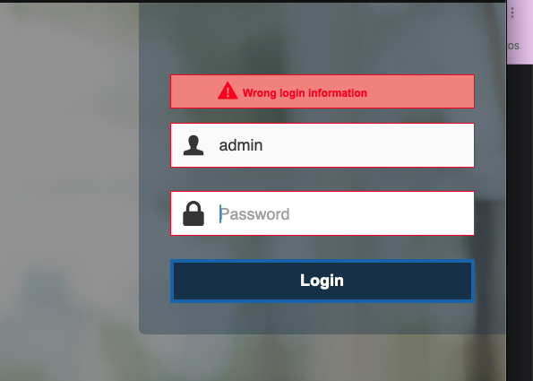

**Figura R1.** Intento de entrar al panel con la contraseña de la etiqueta: "Wrong login information".

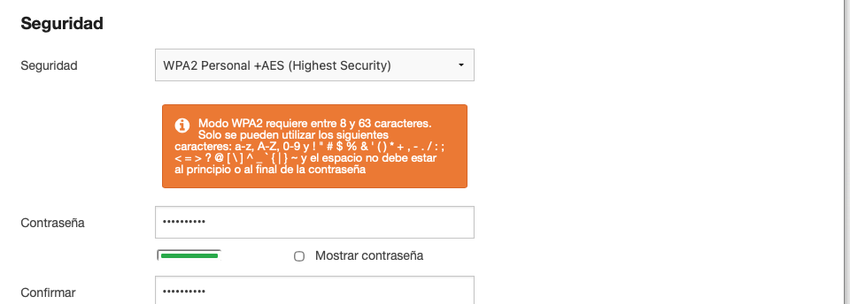

**Figura R2.** Seguridad del Wi-Fi en WPA2 Personal con AES. Recorté la captura para que no se vea el nombre de la red ni el código QR del panel, que tiene la contraseña adentro.

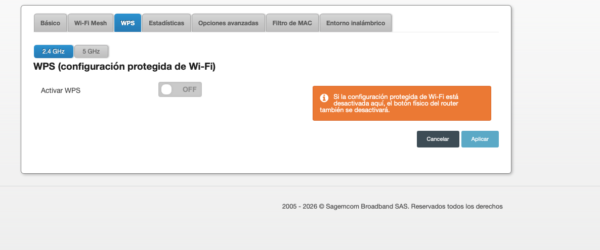

**Figura R3.** WPS apagado en 2,4 GHz.

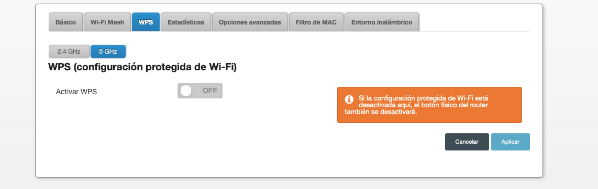

**Figura R4.** WPS apagado en 5 GHz.

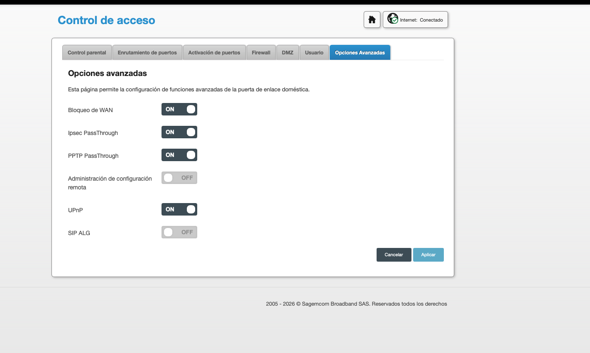

**Figura R5.** Opciones avanzadas del router: bloqueo de WAN activo, administración remota apagada y UPnP activo.

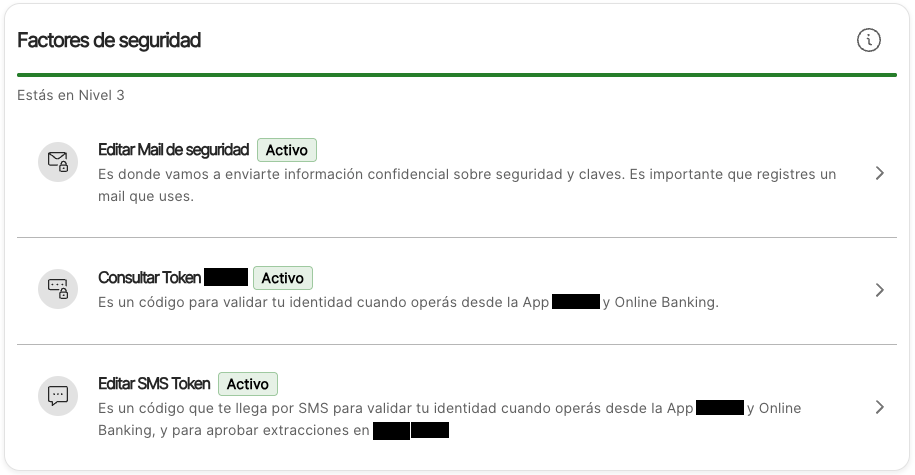

**Figura R6.** Factores de seguridad de la cuenta del banco, todos activos. Tapé el nombre del banco.

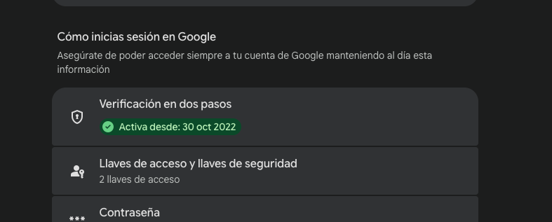

**Figura R7.** Verificación en dos pasos del correo, activa desde octubre de 2022, con dos llaves de acceso.

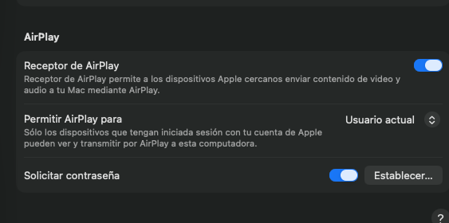

**Figura R8.** AirPlay limitado al usuario actual y con contraseña.

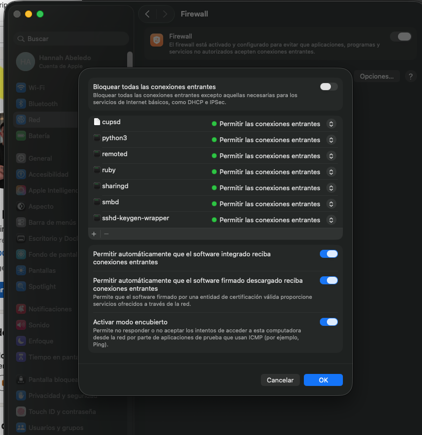

**Figura R9.** Opciones del firewall de macOS con el modo encubierto activado.

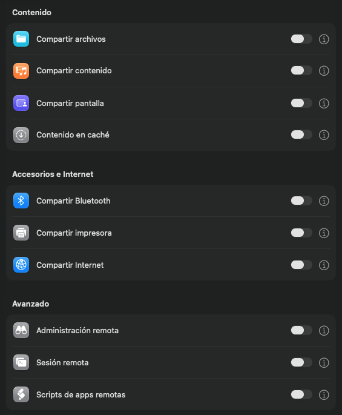

**Figura R10.** Servicios para compartir de macOS, todos apagados (incluidos sesión remota y compartir archivos).

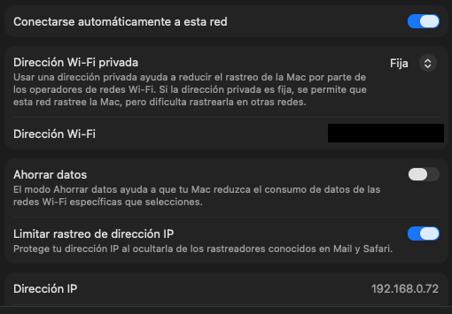

**Figura R11.** Dirección Wi-Fi privada en "Fija". Tapé la dirección MAC.

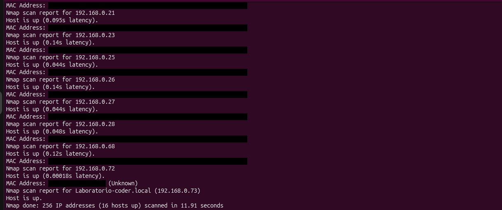

**Figura R12.** Re-escaneo de la red con `sudo nmap -sn 192.168.0.0/24`: 16 equipos. Tapé las MAC y los fabricantes. La Mac (192.168.0.72) aparece como `Unknown`.

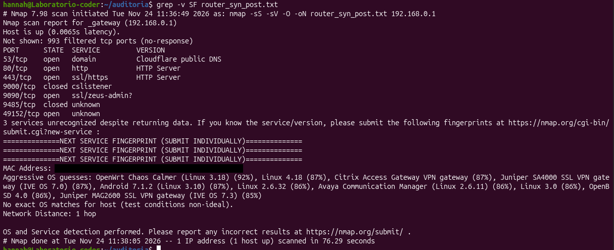

**Figura R13.** Re-escaneo del router con `sudo nmap -sS -sV -O 192.168.0.1`. Mismos puertos que en la Fig. B10.

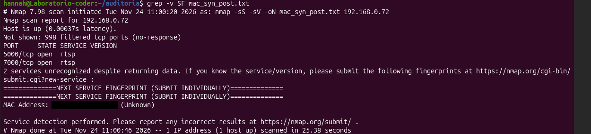

**Figura R14.** Re-escaneo de la Mac con `sudo nmap -sS -sV 192.168.0.72`: `998 filtered tcp ports (no-response)`. En octubre decía `998 closed tcp ports (reset)` (Fig. B6).

---

## Anexo de evidencias

Organicé las capturas por herramienta. Cada una tiene un número, un pie de figura y una explicación de qué se ve y por qué es importante. Los rectángulos negros son datos que tapé por privacidad.

| Grupo | Herramienta | Módulo | Figuras |
|---|---|---|---|
| A | VirtualBox / Ubuntu | 2 | A1 a A9 |
| B | Nmap | 7 | B1 a B11 (sin B8) |
| C | Wireshark | 3 | C1 a C9 |
| D | KeePassXC | 5 | D1 a D4 |
| E | VeraCrypt | 5 | E1 a E11 |

### A. Máquina virtual: VirtualBox y Ubuntu (Módulo 2)

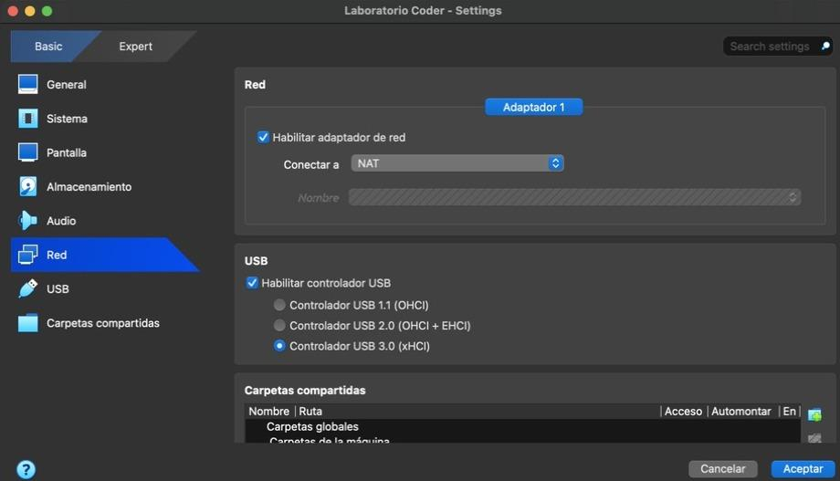

**Figura A1.** Configuración de red de la VM: Adaptador 1 conectado en modo NAT.
Lo configuré antes de prender la VM por primera vez. En NAT, VirtualBox funciona como un router: la VM sale a Internet a través de la computadora pero no tiene una IP propia en mi Wi-Fi, así que ningún otro equipo de la casa puede conectarse a ella. No usé el modo puente (que la deja visible en la red), salvo para el escaneo con Nmap.

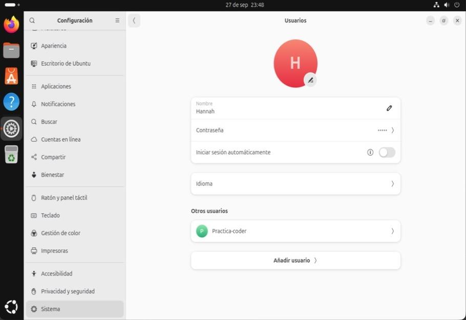

**Figura A2.** Cuentas de usuario: "Hannah" (administradora) y "Practica-coder" en Otros usuarios.
Se ven las dos cuentas que creé. La de administradora la uso solo para tareas que necesitan permisos.

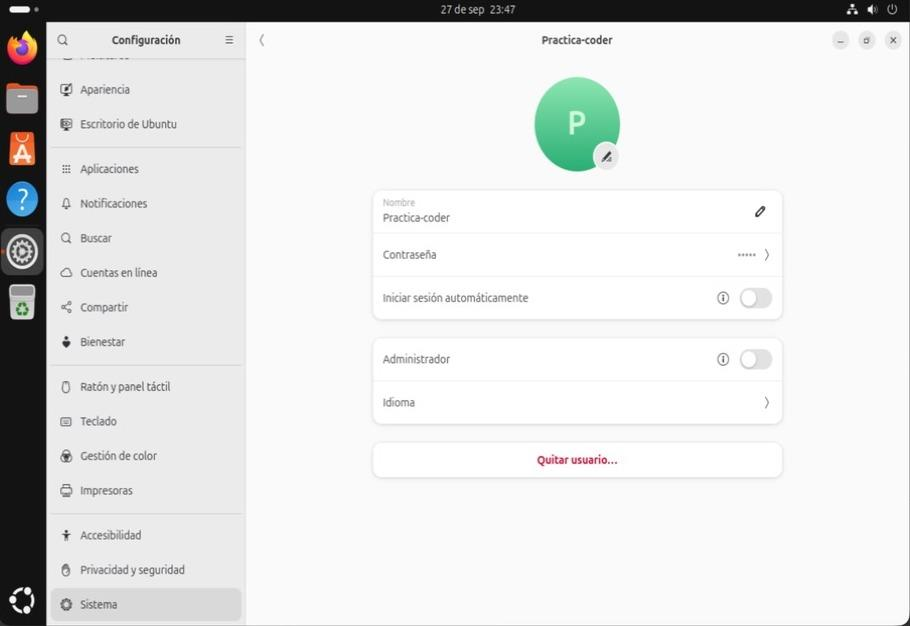

**Figura A3.** La cuenta Practica-coder tiene el interruptor "Administrador" desactivado: es una cuenta estándar.
Es el principio de mínimo privilegio: si algo sale mal mientras uso esta cuenta, el daño queda en sus archivos y no puede cambiar el sistema.

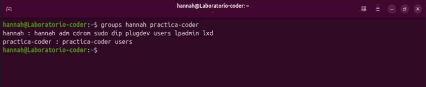

**Figura A4.** Verificación por terminal con `groups`: solo "hannah" pertenece al grupo sudo.
Lo mismo que la captura anterior pero desde la terminal: practica-coder no está en el grupo sudo, así que no puede ejecutar comandos como administrador.

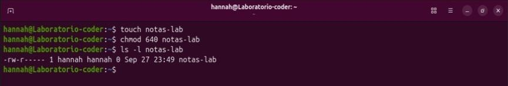

**Figura A5.** Permisos restringidos con `chmod 640`: la cadena `-rw-r-----` en notas-lab.
Se lee en tres partes: el dueño puede leer y escribir (`rw-`), el grupo solo leer (`r--`) y el resto no tiene acceso (`---`). Así Linux evita que otros usuarios del mismo equipo lean el archivo.

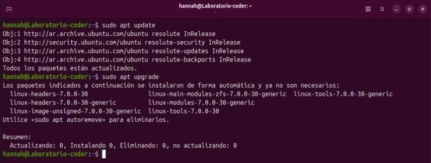

**Figura A6.** Actualización del sistema: `apt update` y `apt upgrade` con "Todos los paquetes están actualizados".
Tener el sistema actualizado cierra vulnerabilidades que ya son conocidas, que son las que más se aprovechan porque cualquiera puede buscarlas.

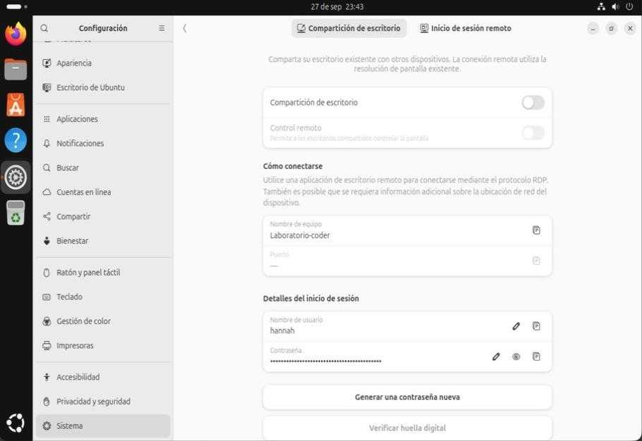

**Figura A7.** Escritorio remoto: "Compartición de escritorio" y "Control remoto" desactivados.
Si no uso el acceso remoto, tenerlo prendido es una puerta abierta de más. Apagarlo achica la superficie de ataque.

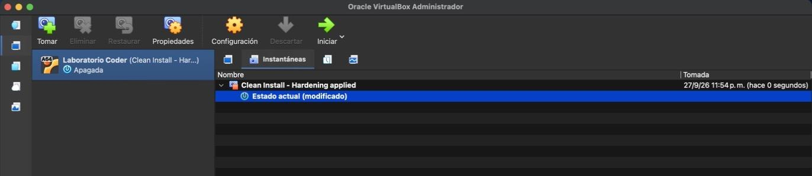

**Figura A8.** Administrador de instantáneas de VirtualBox: snapshot del estado limpio tomado el 27/09/26 (captura original del Módulo 2, cuando todavía se llamaba "Clean Install - Hardening applied").
Por la corrección del TP 2 le cambié el nombre a "Hardening Inicial", y con ese nombre lo usé como base en el TP de Nmap (donde además saqué "Pre-auditoría de red"). Es el punto al que puedo volver si algo sale mal (ver sección 5.1).

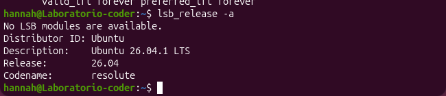

**Figura A9.** Verificación de la versión real del sistema con `lsb_release -a`: Ubuntu 26.04.1 LTS ("resolute").
Con esto corrijo la versión que había puesto en el TP 2. VirtualBox decía "Ubuntu 25.04" porque es solo el perfil que se elige al crear la VM, no lo que está instalado.

### B. Nmap (Módulo 7)

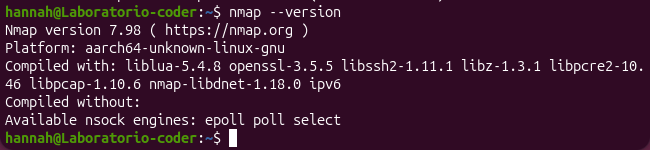

**Figura B1.** Versión de Nmap utilizada (7.98), verificada con `nmap --version`.
Anoto la versión porque otra versión de Nmap podría dar resultados distintos.

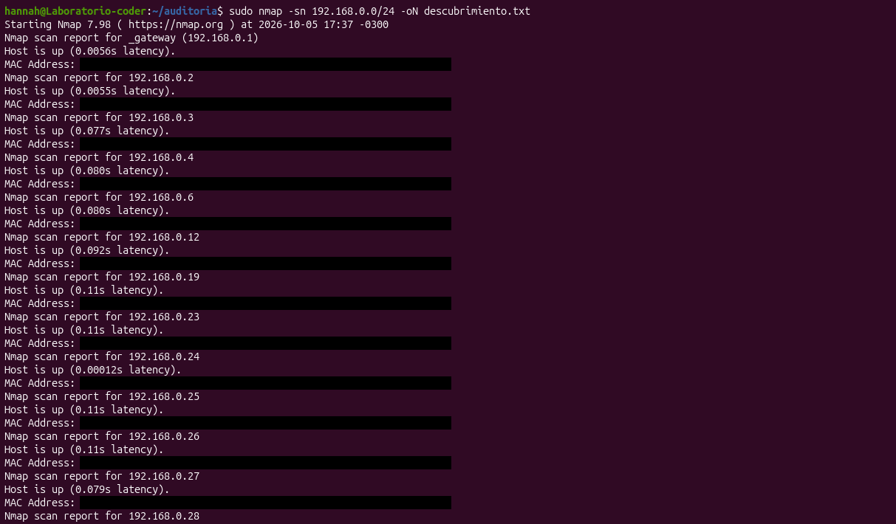

**Figura B2.** Barrido de descubrimiento `sudo nmap -sn 192.168.0.0/24` (primera parte). MAC y fabricantes anonimizados en esta versión.
Con `-sn` Nmap solo busca qué equipos están prendidos, sin revisar sus puertos. Se ven el router (192.168.0.1) y mi computadora (192.168.0.24). Con esto armé la tabla de la sección 3.1.

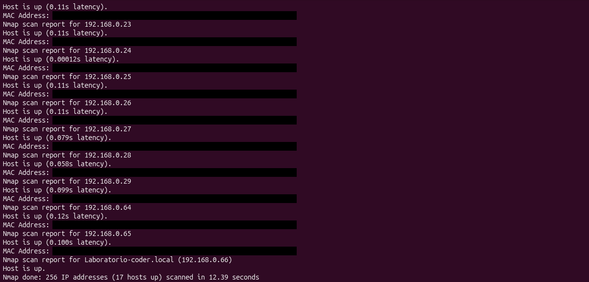

**Figura B3.** Final del barrido: "256 IP addresses (17 hosts up) scanned in 12.39 seconds".
Se confirman los 17 equipos activos. El último, Laboratorio-coder.local (192.168.0.66), es mi máquina virtual. La cantidad de dispositivos inteligentes es la evidencia del hallazgo R4.

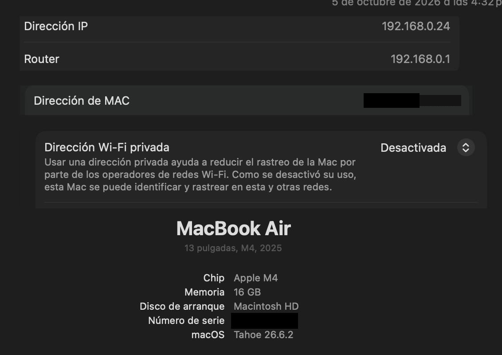

**Figura B4.** Datos reales de la Mac: IP, router, MAC (anonimizada), "Dirección Wi-Fi privada: Desactivada" y versión de macOS. Número de serie oculto.
Sirve para comparar lo que dijo Nmap con la realidad (hallazgo M4). También muestra el hallazgo M3: el mismo macOS avisa que, con la dirección privada desactivada, la Mac se puede rastrear en otras redes.

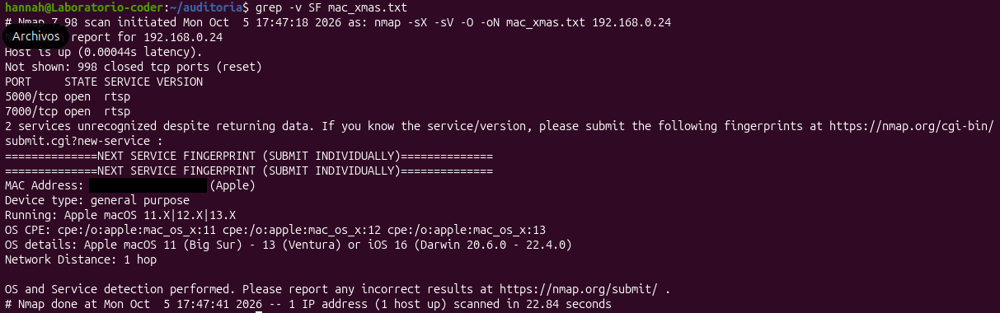

**Figura B5.** Escaneo Xmas de la Mac (`nmap -sX -sV -O 192.168.0.24`), filtrado con `grep -v SF`.
Resultado: 998 puertos cerrados ("reset") y solo el 5000 y el 7000 abiertos. Como la Mac contesta con un rechazo en los puertos cerrados, el Xmas los puede distinguir (hallazgo M2). El cartel "Archivos" es un aviso de Ubuntu que tapa parte de la primera línea.


**Figura B6.** Escaneo SYN de la Mac (`nmap -sS -sV -O 192.168.0.24`).
Da lo mismo que el Xmas: solo el 5000 y el 7000 abiertos. Nmap estima macOS 11 a 13, pero tengo macOS 26 (hallazgo M4).

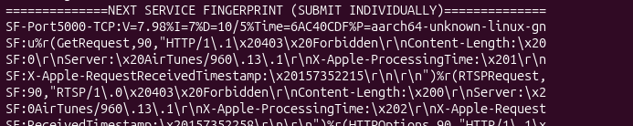

**Figura B7.** Fragmento de la respuesta del puerto 5000: "HTTP/1.1 403 Forbidden" y "Server: AirTunes".
Nmap no completó la columna VERSION, pero en esta respuesta se ve que es AirPlay de Apple y que rechaza el pedido porque no está autorizado. Por eso M1 tiene gravedad baja.

> **Figura B8** (foto de la etiqueta del router): no se incluye en la versión pública porque identifica el equipo y la red.

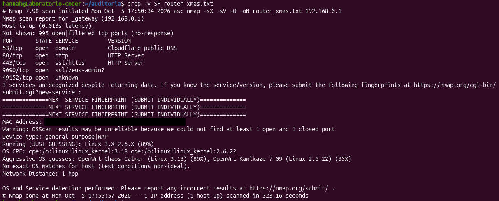

**Figura B9.** Escaneo Xmas del router (`nmap -sX -sV -O 192.168.0.1`). Duración: 323,16 s. MAC y fabricante anonimizados.
El router no contesta los paquetes Xmas en 995 puertos, que quedan como `open|filtered` porque el Xmas no puede saber si están cerrados o bloqueados. Por eso Nmap avisa que la detección del sistema no es confiable ("JUST GUESSING").

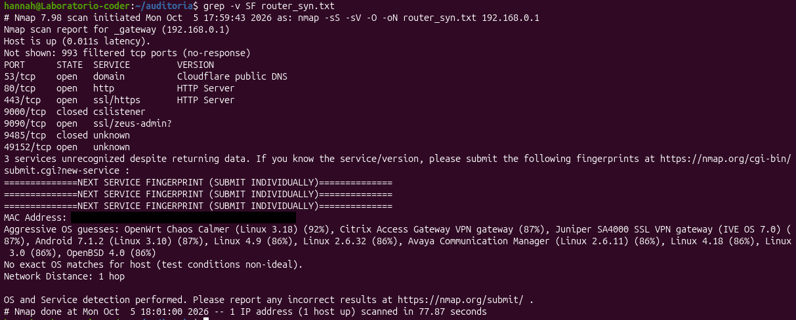

**Figura B10.** Escaneo SYN del router (`nmap -sS -sV -O 192.168.0.1`). Duración: 77,87 s. MAC y fabricante anonimizados.
Este sí separa: 993 puertos filtrados por el firewall, 2 cerrados (9000 y 9485) y 5 abiertos: 53 (DNS), 80 (HTTP), 443 (HTTPS), 9090 ("ssl/zeus-admin?") y 49152 ("unknown"). Es la evidencia de R1, R2, R3 y R5. Lo bueno es que el firewall bloquea 993 de los 1000 puertos.

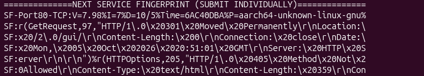

**Figura B11.** Fragmento de la respuesta del puerto 80 del router: "HTTP/1.0 301 Moved Permanently" con "Location: /2.0/gui/".
Como redirige a una dirección relativa, el navegador sigue en HTTP y el login del panel viajaría sin cifrar (hallazgo R2).

### C. Wireshark (Módulo 3)

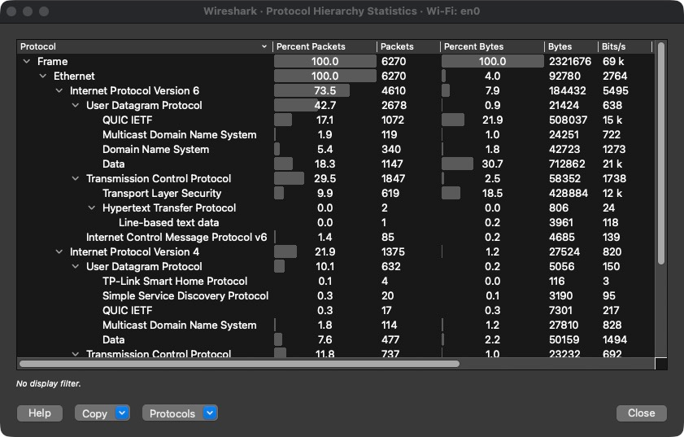

**Figura C1.** Statistics → Protocol Hierarchy (parte 1): tráfico IPv6, con QUIC, MDNS, DNS, TCP, TLS y HTTP.
Muestra todos los protocolos de la captura (6.270 paquetes). Me sirvió para separar lo que viaja cifrado (TLS, QUIC) de lo que viaja en texto plano (HTTP, DNS, MDNS).

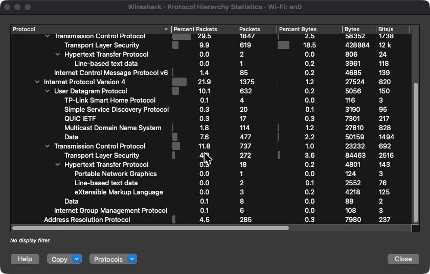

**Figura C2.** Protocol Hierarchy (parte 2): tráfico IPv4 y ARP.
Acá aparecen también SSDP, un protocolo de descubrimiento de dispositivos inteligentes y ARP, todos sin cifrar.

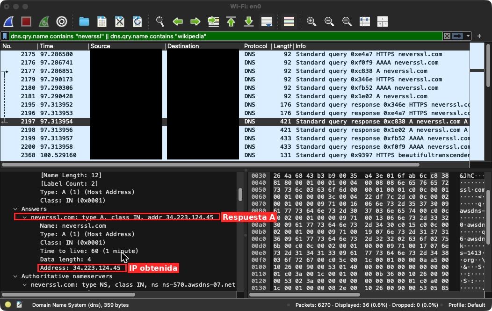

**Figura C3.** Filtro DNS: respuesta tipo A para neverssl.com con la IP 34.223.124.45. Direcciones IPv6 propias y del servidor DNS del proveedor anonimizadas.
Antes de entrar a un sitio, el navegador le pregunta la IP al servidor DNS, y esa pregunta viaja sin cifrar. Cualquiera en la red puede ver qué sitios busco, aunque después use HTTPS (hallazgo W2).

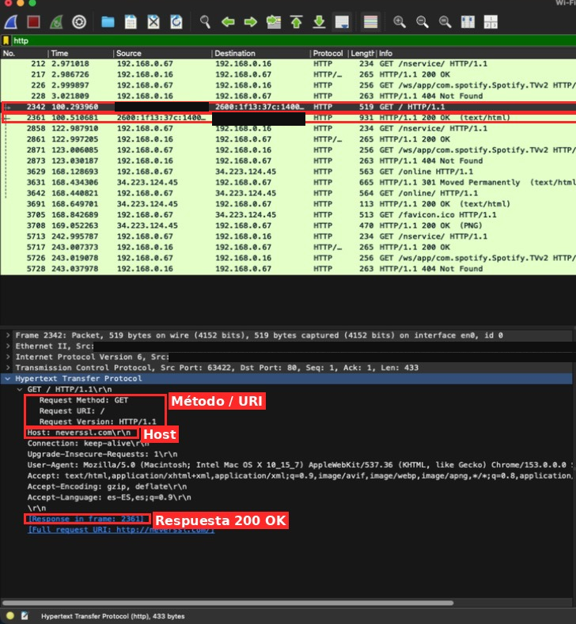

**Figura C4.** Filtro `http`: solicitud GET en el paquete 2342 con Método/URI, Host y enlace a la respuesta 200 OK.
Abajo se leen el método GET, la URI "/", el Host neverssl.com, el User-Agent (navegador y sistema) y el idioma. Todo esto lo podría ver cualquiera en la misma Wi-Fi (W1 y sección 4.3).

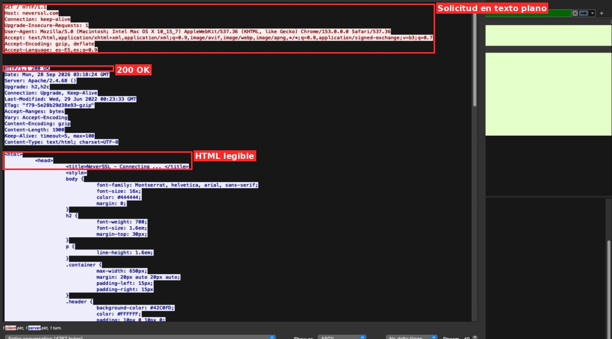

**Figura C5.** Follow → HTTP Stream: en rojo la solicitud de mi navegador, en azul la respuesta del servidor y el HTML legible.
Muestra que se puede reconstruir toda la conversación. El fragmento está copiado en la sección 4.2.

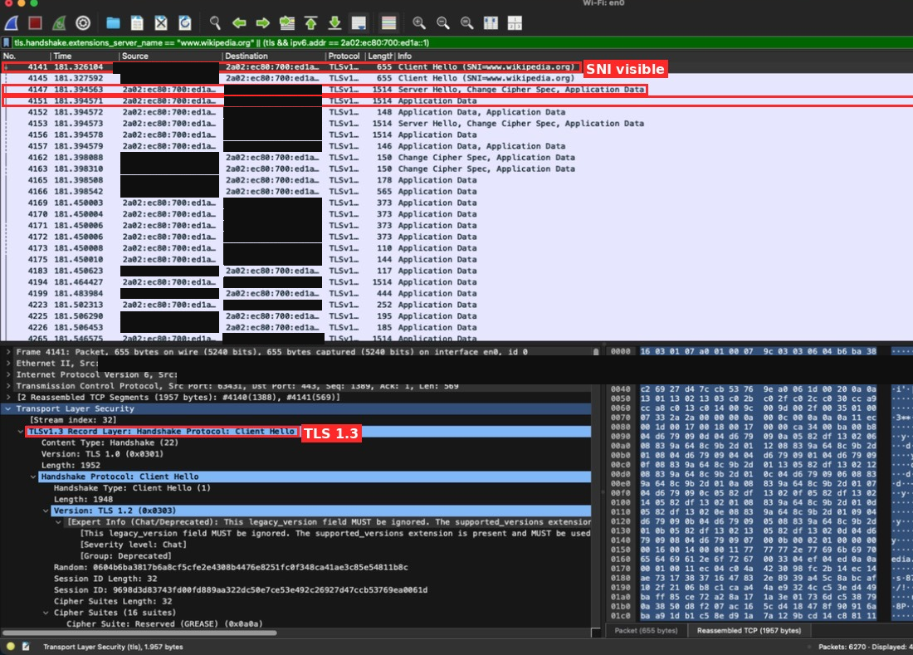

**Figura C6.** Filtro TLS de la conexión con Wikipedia: Client Hello con el SNI visible, Server Hello (TLS 1.3) y paquetes Application Data.
Después del Server Hello solo aparece "Application Data", porque el contenido está cifrado. Lo único que se lee es el nombre del sitio (SNI) en el primer mensaje.

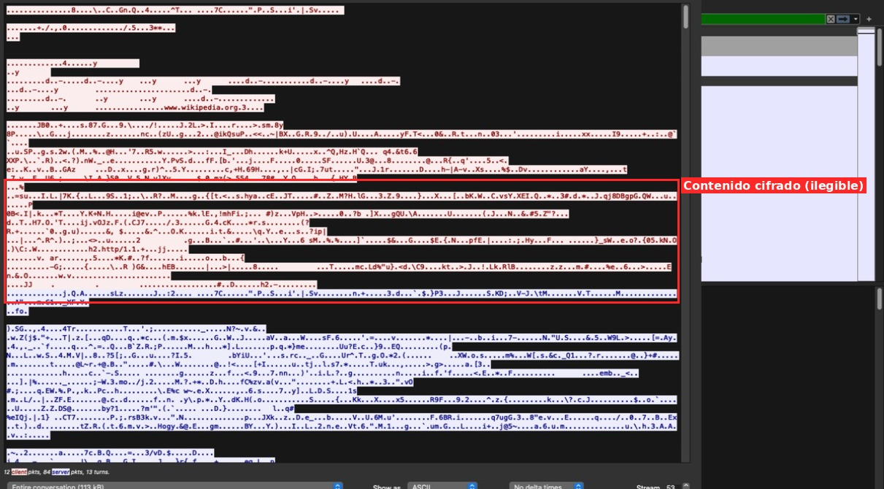

**Figura C7.** Follow → TCP Stream de la conexión HTTPS con Wikipedia: solo caracteres sin sentido.
Es lo mismo que la Fig. C5 pero con HTTPS. Comparando las dos se ve claramente lo que hace TLS: el contenido no se puede leer.

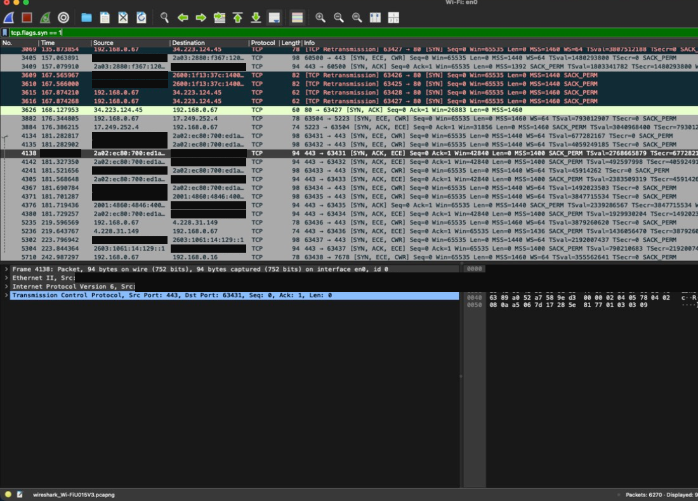

**Figura C8.** Filtro `tcp.flags.syn == 1`: los paquetes SYN y SYN-ACK de varias conexiones.
Muestra los dos primeros pasos de cada conexión TCP. El tercer paso (ACK) no tiene la bandera SYN y por eso no aparece con este filtro.

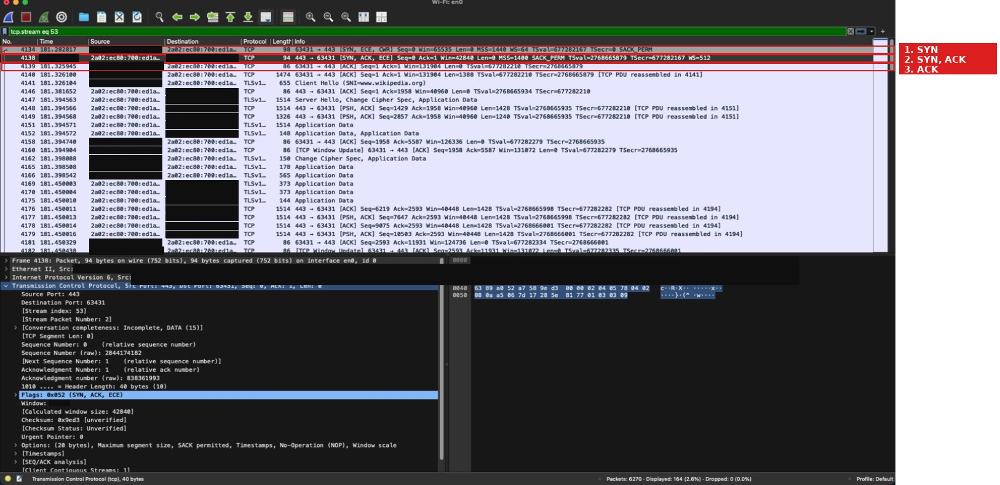

**Figura C9.** Filtro `tcp.stream eq 53`: three-way handshake con Wikipedia (SYN, SYN-ACK, ACK) y detalle del paquete 4138.
En el detalle se ven los números relativos y absolutos ("raw") que usé en la tabla de la sección 4.2: Sequence Number 0 (raw 2844174182) y Acknowledgment Number 1 (raw 838361993).

### D. KeePassXC (Módulo 5)

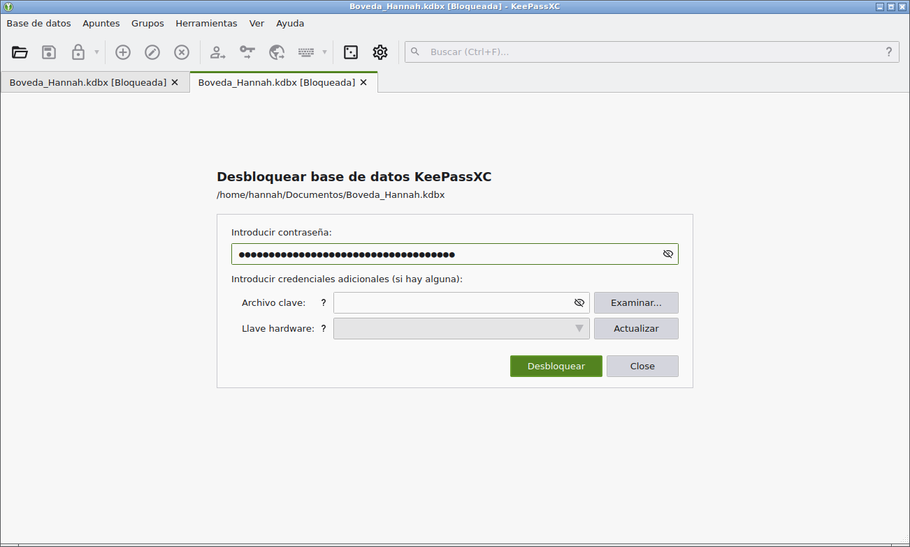

**Figura D1.** Desbloqueo de la bóveda de laboratorio con la contraseña maestra.
La bóveda es un archivo cifrado en la computadora y sin la contraseña maestra no se abre. Es la única contraseña que hay que recordar.

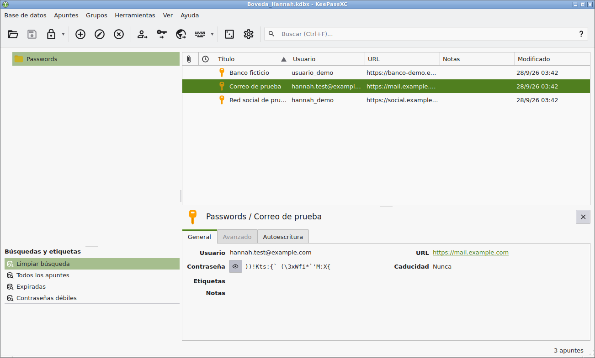

**Figura D2.** Las tres entradas de prueba (correo, banco y red social ficticios) con dominios example.com.
Usé cuentas inventadas para no mostrar datos reales. Cada una tiene su propia contraseña generada al azar.

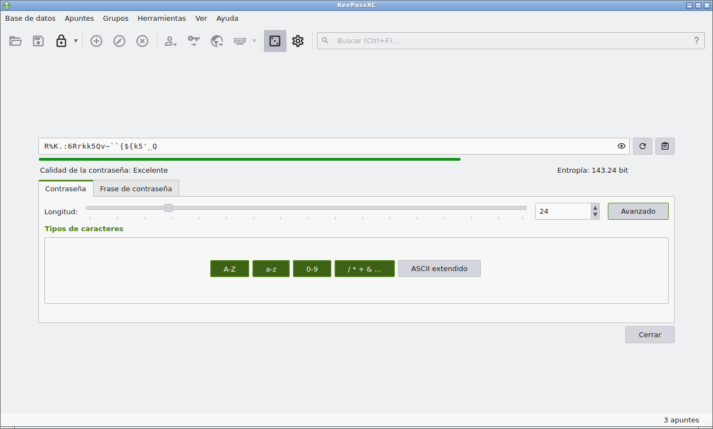

**Figura D3.** Generador de contraseñas: 24 caracteres, cuatro tipos de caracteres, calidad "Excelente" y entropía de 143 bits.
Supera el mínimo de 16 caracteres que pedía la consigna. Una contraseña al azar de este largo es prácticamente imposible de adivinar y, como es única, no sirve para entrar a otras cuentas.

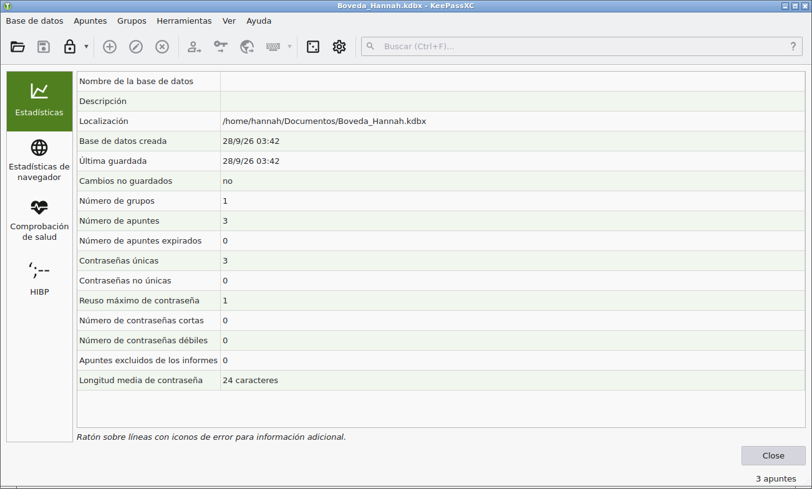

**Figura D4.** Informe de estadísticas de la base: 3 contraseñas únicas, 0 reutilizadas, 0 cortas, 0 débiles, largo medio 24.
Con el informe de KeePassXC compruebo que ninguna contraseña se repite. Esto resuelve el problema de las contraseñas repetidas (I1) en las cuentas que se guarden ahí.

### E. VeraCrypt (Módulo 5)

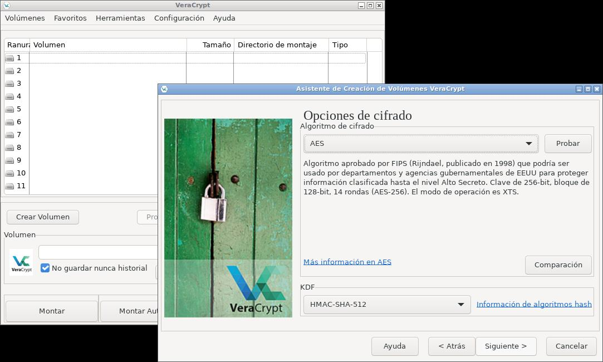

**Figura E1.** Opciones de cifrado: algoritmo AES (clave de 256 bits) y hash HMAC-SHA-512.
AES es el algoritmo de cifrado más usado. El hash se usa para generar la clave a partir de la contraseña y hace más lento un ataque de fuerza bruta.

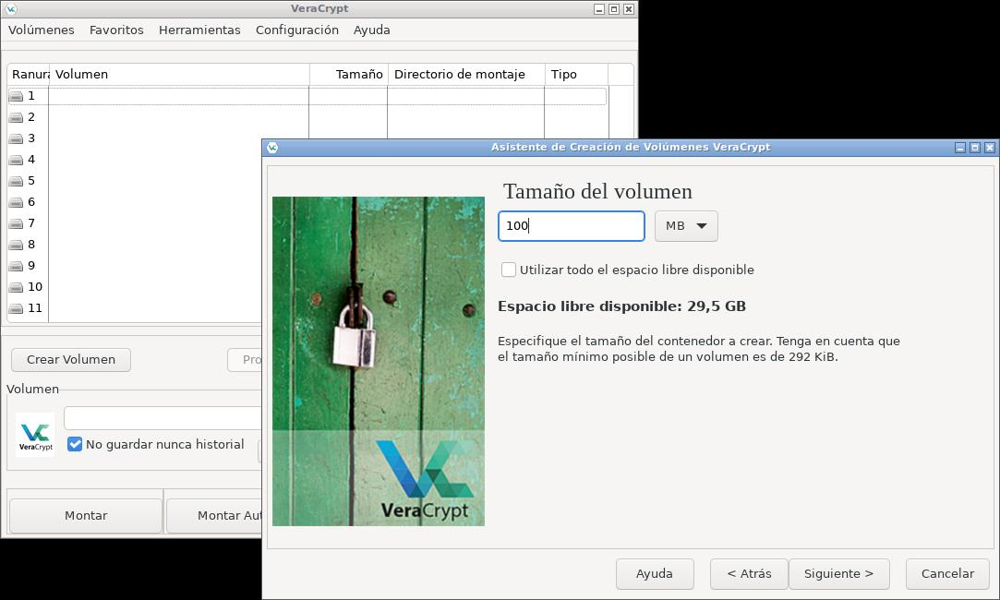

**Figura E2.** Tamaño del volumen: 100 MB (en VeraCrypt, MB = 1.048.576 bytes).
Ver la aclaración de la sección 5.1 sobre la diferencia entre MB y MiB.


**Figura E3.** Formato del volumen: sistema de archivos exFAT.
exFAT es compatible con Windows, macOS y Linux, así que el contenedor puede abrirse en cualquier computadora.

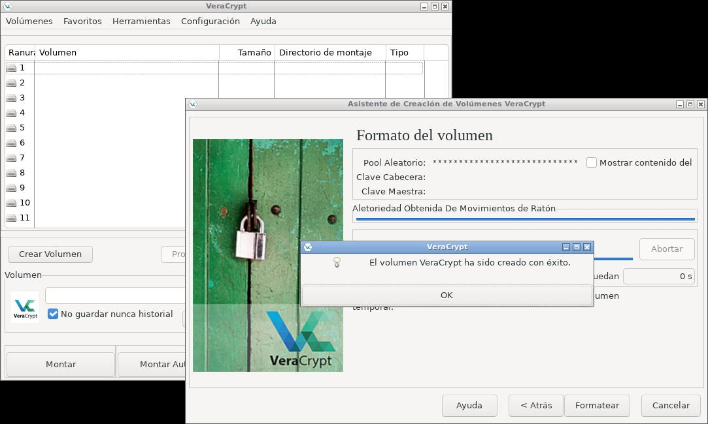

**Figura E4.** Confirmación: "El volumen VeraCrypt ha sido creado con éxito".
Antes de formatear moví el mouse al azar, porque VeraCrypt usa esos movimientos para generar las claves.

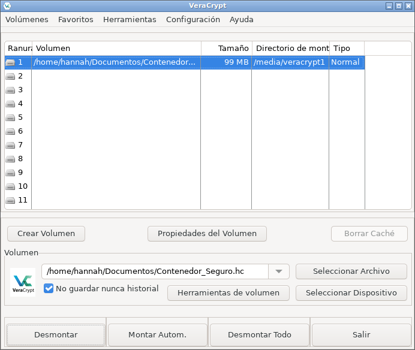

**Figura E5.** Volumen montado en la ranura 1: 99 MB en `/media/veracrypt1`.
Mientras está montado funciona como un disco más, y todo lo que se guarda ahí se cifra solo.

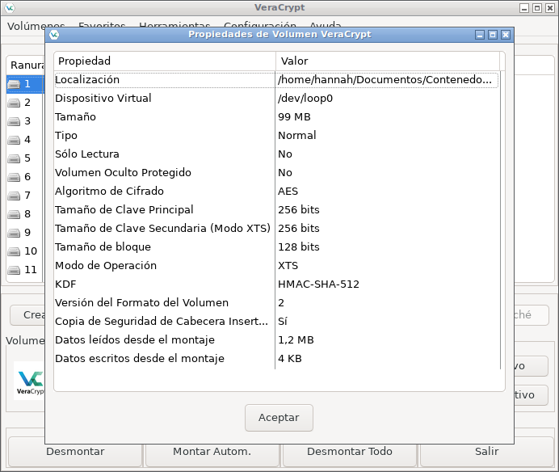

**Figura E6.** Propiedades del volumen: AES, clave de 256 bits, modo XTS, HMAC-SHA-512.
Confirma lo que elegí en el asistente.


**Figura E7.** Terminal: copia de `evidencia.txt`, `secreto.txt` y una imagen al volumen y borrado seguro de los originales con `shred -u -z -n 3`.
`shred` escribe encima de los archivos varias veces antes de borrarlos, así no quedan copias sin cifrar en el Escritorio. Después el Escritorio queda vacío y los archivos están dentro del volumen.


**Figura E8.** Explorador de archivos dentro del volumen: `evidencia.txt`, `foto_prueba.png` y `secreto.txt` (total 99,8 MiB).
Se ven los archivos dentro del contenedor y el tamaño real.


**Figura E9.** Menú Herramientas de volumen → "Copia de Seguridad de Cabecera de Volumen".
Desde acá se hace la copia de la cabecera, que es donde están las claves del volumen.


**Figura E10.** Confirmación final: "La copia de seguridad de la cabecera del volumen ha sido creada con éxito".
El aviso dice que la copia solo sirve para este volumen y que, si se restaura, también vuelve la contraseña que tenía en ese momento.


**Figura E11.** Intento de leer el contenedor sin VeraCrypt (volumen desmontado): símbolos ilegibles y `grep` con 0 resultados.
En el listado se ven el contenedor (104.857.600 bytes = 100 MiB) y el archivo `Contenedor_Seguro_cabecera_backup` (131.072 bytes = 128 KiB). Cuando busco las frases que guardé adentro, `grep` devuelve 0: sin la contraseña no se puede leer nada.
